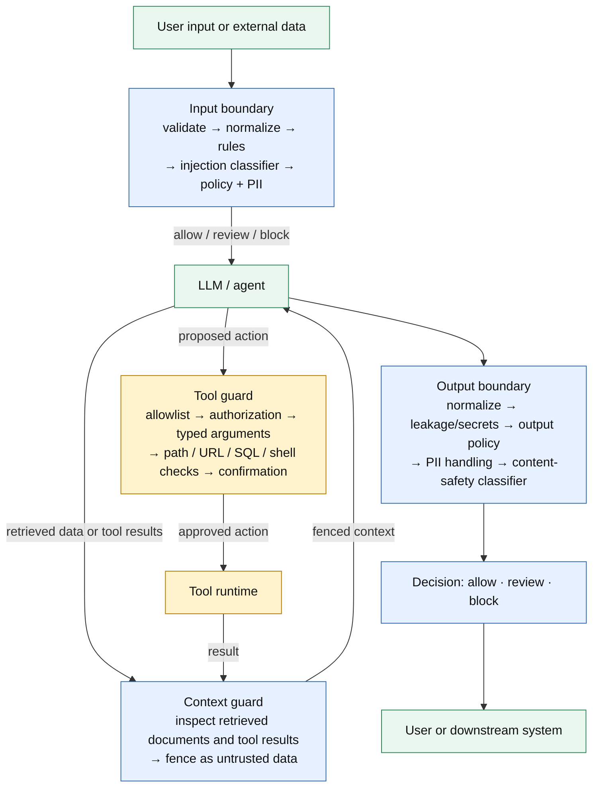

# Defense-in-Depth Security Architecture for LLM Applications

LLM applications introduce a new security boundary: natural-language input can influence model behavior, and model behavior can trigger real-world actions. Treat user input, retrieved content, model output, and tool arguments as untrusted.

The core rule is simple:

> The LLM can recommend. The application decides.

## Architecture

## Control layers

### 1. Validate and normalize

Reject malformed, oversized, or invalid requests before expensive processing. Canonicalize Unicode, remove invisible characters, decode supported entities once, normalize whitespace, and reject illegal control characters.

### 2. Use deterministic rules first

Rules provide fast, explainable protection for high-confidence signals: instruction overrides, fake system markers, chat-template tokens, known secrets, private keys, and encoded payloads.

### 3. Classify uncertainty

Use an injection classifier for suspicious intent that does not match an exact phrase. Score long inputs in overlapping chunks. Map results to `allow`, `review`, or `block`; never treat an unavailable classifier as permission to proceed.

### 4. Enforce application policy outside the model

Policy evaluates authorization and business context, not just malicious intent:

- user roles and allowed capabilities;
- blocked topics and application-specific rules;
- PII action: block, redact, or flag;
- tool allowlists and high-impact confirmation requirements.

Keep trusted instructions separate from user prompts, retrieved documents, and tool results. Fencing or “spotlighting” untrusted content helps prevent data from being interpreted as instructions.

### 5. Validate output before release

A safe prompt does not guarantee a safe response. Inspect the response for system-prompt leakage, credentials, unsafe content, blocked topics, PII, dangerous HTML/links/images, and SQL-like output. Return only the normalized and redacted value; omit rejected content.

### 6. Guard actions at execution time

An output approval is not tool authorization. Before executing a model-proposed action, validate the tool name, caller authorization, argument types and limits, filesystem scope, URL destination, SQL mode, shell metacharacters, and required human confirmation. Apply the same checks again at the execution boundary where practical.

## Operational rules

- Fail closed: unavailable or unparseable security stages produce `review`.
- Keep decisions explainable: return the verdict, stage, violations, and model results.
- Audit without collecting secrets: log identifiers and cryptographic hashes, not raw prompts or responses.
- Bound consumption with input/output limits, request limits, token budgets, and bounded classifier work.
- Pin model revisions and disable remote model code execution.
- Enforce identity, tenant isolation, least privilege, parameterized queries, and final-sink output encoding outside the LLM guard.

Defense in depth does not make any individual rule or model perfect. It ensures that a missed pattern, classifier error, policy gap, or model outage does not automatically become an unsafe action or data disclosure.
